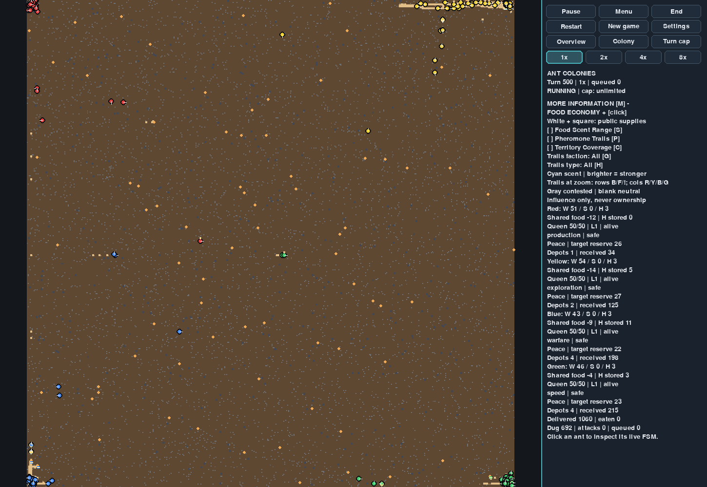
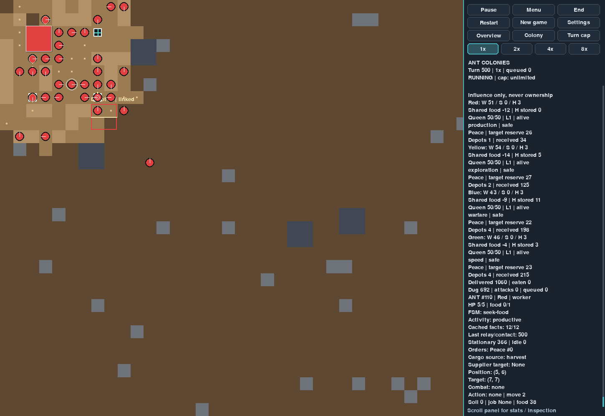

# Performance-First Autonomous Behavior — Completion Report

## Delivery and scope

The source and portable Windows executable have been updated in `D:\Codex\ant`. Move the entire ant folder and double-click ant.exe. Keep _internal beside it. Python is not required for play. All release text is English. The original reference and three protected design documents are unchanged (SHA-256 evidence in AUTONOMY_SUMMARY.json). No additional development phase was started.

Supply Depot V2 remains authoritative: 15 food, at least two builders, 20 worker-turn units, and completed depot deliveries credit the living queen balance. This update does not revert it to the earlier physical independent-inventory prototype. Food upkeep remains every 100 completed turns, with direct source, friendly Honeypot, own cargo, shared signed reserve, then existing debt/starvation rules. Honeypot cost 5, capacity 10, zero upkeep and exact neutral death drops remain unchanged.

## 1. Diagnosis before implementation

The baseline passed all 287 tests (17.373 seconds). Inspection and profiling found that apparent inactivity often represented legitimate guarding, supplier holding, gathering or navigation dependencies. Natural baseline unproductive-idle samples were only 43/52/40 across seeds 7/19/42; constant movement would have been a misleading objective. Actual problems included repeated scout reassignment after births, stale Honeypot support commitments, unnecessary candidate route requests, field-cache churn, weak useful fallback assignments, and absent universal physical fact relay. Depot planning could previously read a faction-wide observation pool without a contact chain.

The 1,000-ant/20-turn baseline cProfile recorded about 19.7 million calls in 5.946 seconds; AI planning used 4.615 seconds inclusive, field expansion 1.417 seconds, local observation 1.106 seconds and distance calls 0.999 seconds. The final comparable profile recorded 16.78 million calls in 5.501 seconds, AI planning 4.337 seconds, field expansion 1.447 seconds, observation 1.215 seconds and distance 0.862 seconds. Inclusive totals overlap and must not be added. New communication adds work; shared navigation and sensing remain the principal costs. See the before/after .profile.txt and .prof files.

## 2. Architecture and bounded work

Workers, soldiers and Honeypots all carry immutable, time-stamped facts: food, enemy, danger, route, useful excavation and supply. Actual local observations enter bounded personal memory. The existing spatial communication pass gathers contact messages from a snapshot, then applies them; there is no same-turn cascading relay or new global knowledge pool. Original timestamps survive hops. Soldiers can inform workers of food; they never gain worker harvesting/delivery roles. Enemy warnings provide last-seen coordinates, not remote live tracking. Queen orders keep their existing physically propagated versions. Queenless ants retain gossip without restoring queen powers.

Defaults: communication radius 2; sender phases every 4 turns; 16 examined spatial entries, 2 recipient candidates and 2 message intents per sender; at most 128 accepted events per turn. Per ant: 12 facts, 24 deduplication entries and 24 remembered food observations/coordinates. Food/route TTL is 128 turns, enemy/danger 16, excavation/supply 32. Positive food updates are throttled to four turns; observed depletion is immediate. Identical valid content is suppressed. Rotating bucket offsets advance by planning epoch to avoid phase-alias starvation. Bounded contacts can delay delivery or let facts expire; delivery to every ant is not guaranteed.

Local frontier, patrol, escort and up to four queen guard posts per faction use committed tasks rather than random visible activity. Nonurgent planning uses 8-turn ID phases, 16 at 1,000 living ants, with at most 8 new local tasks, 8 shared expedition assignments and 4 exceptional local path retries per turn. Local steering normally avoids a global search. Scouts retain roster commitments across births and at most two shared geographic routes per faction; frontier choice uses the leader’s own surveyed geography. Immediate combat, food return, survival and active construction keep precedence. Honeypot retreat and physical loading remain immediate; nonurgent support is staggered. Remote Honeypot stock and other workers’ uncommunicated enemy sightings are not available to planners.

Navigation retains static/dynamic separation, localized terrain invalidation, the 65,536-node turn budget, 256-node quantum and 64-job queue. The bounded field cache increases from 24 to 48 after measured churn. Delivery endpoints are ordered by admissible lower bounds; a search is skipped only when an exact known cost proves that candidate cannot improve the winner. A distant pending route cannot suspend a proven nearest endpoint. No sensing, combat, reproduction, occupancy, movement budget or population cap is reduced. Exact queen-footprint distance arithmetic replaces repeated allocation without changing distance semantics.

Excavation advice is useful only for adjacent ordinary soil with real traffic at the existing threshold; at most one advice task per faction per turn. An early prototype flooded facts from already widened cells and was rejected. Automatic fill no longer narrows widened passages; manual fill and material accounting remain intact. Complex new fortification planning is deferred. Inspection separately displays productive activity, strategic holds, dependency waits, temporary obstruction and unproductive idle, plus cached facts/contact and cumulative stationary/idle counts. Overlays remain observational.

## 3. Matched population benchmarks

Same machine, Windows 11, Python 3.13.5, NumPy 2.5.4, Pygame 2.6.1. Both versions use the same distributed initial population fixture, 512×512 map, seed 7 and 30 completed turns, repeated three times. Metrics below pool all 90 turn samples at each size. Timing includes advance(1); observational audits run outside the timed interval. These compare this task’s actual original source, not historical Phase 4E timings.

| Starting ants | Version | Mean ms | Median ms | p95 ms | Worst ms | Final population |
|---:|---|---:|---:|---:|---:|---:|
| 100 | Before | 34.22 | 33.70 | 40.24 | 42.24 | 146 |
| 100 | After | 27.11 | 27.05 | 29.22 | 31.53 | 145 |
| 500 | Before | 85.54 | 84.53 | 97.26 | 111.35 | 436 |
| 500 | After | 80.17 | 80.14 | 83.72 | 87.76 | 429 |
| 1000 | Before | 119.01 | 117.70 | 133.44 | 153.09 | 742 |
| 1000 | After | 110.53 | 109.66 | 119.13 | 151.02 | 750 |

At 1,000 starting ants mean time improves 7.13% (about 9.05 completed turns/second), meeting the no-more-than-5%-regression target. Population changes are real AI outcomes: before/after births and deaths are 50/4 versus 50/5 at 100, 7/71 versus 0/71 at 500, and 17/275 versus 17/267 at 1,000. The 1,000-ant improvement is not explained by more deaths; after retains eight more ants. These are changed gameplay trajectories, so not all gains can be credited to a faster algorithm.

The worst after-turn is still 151.02 ms, above its 119.13 ms p95. Profiling attributes recurring work to bounded navigation expansion and per-ant sensing/planning; it does not establish a single cause for that individual unprofiled outlier. No samples are discarded. The Pygame loop remains synchronous, so this release does not guarantee sub-100-ms input response or claim asynchronous execution.

### Frozen navigation workload

A separate frozen 512×512 seed-7 workload repeats the same 32 source/destination requests for 40 batches, without simulation progression or differing deaths. All 1,280 requests succeed in both versions and every cost matches. Total navigation time falls from 535.55 to 158.13 ms (mean batch 13.39 to 3.95 ms; worst 14.28 to 9.41 ms). Final measured cache storage increases from 25,188,448 to 33,728,808 bytes because the 32 destinations now fit. This isolates the cache benefit; it is not a general claim for all maps or workloads. Raw results include costs and counters.

## 4. Three-seed natural gameplay

Each version starts with the normal eight workers, four queens and default abilities on a 512×512 map. All three games complete 500 turns. Before natural rows use the same refined stationary/stuck classifier as after. The original BEFORE.jsonl initial natural stuck proxy included legitimate holds; use BEFORE_NATURAL.jsonl for these comparisons.

| Seed | Version | Final ants | Mean / median / p95 / worst ms | Explored faction-cell pairs | Food discoveries | Harvested | Delivered | Depots / depot deliveries |
|---:|---|---:|---|---:|---:|---:|---:|---:|
| 7 | Before | 193 | 30.27 / 33.65 / 58.02 / 63.35 | 4236 | 21 | 1330 | 1078 | 9 / 582 |
| 7 | After | 206 | 26.67 / 27.79 / 52.93 / 60.07 | 8551 | 25 | 1327 | 1060 | 11 / 572 |
| 19 | Before | 203 | 24.50 / 25.63 / 45.39 / 65.18 | 5785 | 13 | 1232 | 991 | 8 / 500 |
| 19 | After | 209 | 25.57 / 27.02 / 47.86 / 55.33 | 8130 | 18 | 1251 | 989 | 8 / 517 |
| 42 | Before | 190 | 27.69 / 27.85 / 55.28 / 89.80 | 5650 | 15 | 1244 | 1062 | 8 / 598 |
| 42 | After | 215 | 27.20 / 28.88 / 51.78 / 66.92 | 7478 | 22 | 1283 | 971 | 9 / 469 |

| Seed | Version | Idle | Strategic stationary | Dependency waits | Temporarily blocked | Stuck events | Oscillation events | Excavated / fill / stone | Accepted fact relays |
|---:|---|---:|---:|---:|---:|---:|---:|---|---:|
| 7 | Before | 43 | 1124 | 15363 | 177 | 7 | 2254 | 545 / 177 / 17 | 0 |
| 7 | After | 10 | 1197 | 13483 | 1341 | 0 | 1376 | 692 / 150 / 14 | 20574 |
| 19 | Before | 52 | 1046 | 9757 | 181 | 4 | 2210 | 498 / 181 / 22 | 0 |
| 19 | After | 22 | 1676 | 12010 | 1400 | 1 | 1523 | 506 / 157 / 8 | 21252 |
| 42 | Before | 40 | 891 | 14311 | 143 | 3 | 2040 | 397 / 183 / 22 | 0 |
| 42 | After | 16 | 1834 | 12631 | 1307 | 1 | 1232 | 296 / 154 / 48 | 21396 |

Activity entries are ant-turn samples, not percentages or consecutive durations; populations differ. Explored area counts actual visited cells separately by faction, so overlapping faction coverage counts twice. Discovery counts remembered observed source IDs. Strategic stationary includes Honeypot holds and guard/patrol holds; it is not a soldier-only guard metric. Stuck counts reaching ten blocked turns while classified temporarily blocked. Oscillation counts overlapping ABAB position windows, excluding actions and recognized holds; it is a diagnostic proxy, not proof each episode is wasteful.

Exploration and discovery improve in all seeds and unproductive idle declines from an already low baseline. Food delivery is not uniformly better: seed 42 delivers 971 versus 1,062, and seed 7 1,060 versus 1,078. Temporary blockage samples increase while prolonged stuck and oscillation proxies fall; new committed destinations also change classification. More roaming is not automatically better economy. Seed 19 natural mean rises about 4.36% with six more final ants; the other natural means fall. Natural final populations contain workers and Honeypots, with no soldiers; soldier communication/combat evidence comes from focused tests and the mixed population fixtures, not an invented natural battle. Defensive fill counts do not imply a new autonomous fortification system.

Actual accepted relay counts are 20,574 / 21,252 / 21,396, peaks 83 / 84 / 94 events per turn, below the 128 cap. Maximum fact memory is 12. Field builds drop from 8,249 / 2,910 / 5,162 to 678 / 553 / 592; cache hit rates after are about 99.2%. Natural final cache storage is about 50.7–51.0 MB versus 25.2 MB before. These are measured navigation structures, not total process RSS; total process memory was not separately instrumented.

## 5. Tests and soldier verification

Baseline: 287 passed in 17.373 seconds. Final: **321 passed in 19.623 seconds**. All 287 original test methods remain, plus 34 new deterministic cases. No existing assertion was removed or weakened. Two depot tests now seed an ant’s food_observations instead of the old instantly shared depots.known pool; their construction/economy assertions are unchanged. This fixture change is required by physical knowledge propagation.

New tests cover all fact types and unit kinds, a soldier discovering food and physically informing a worker that harvests and delivers it, a worker warning a soldier without live remote tracking, multihop boundaries, enemy exclusion, unchanged-content suppression, TTL and bounded caches, crowd contact rotation, queenless relay, no instantaneous depot food/danger pool, useful frontier planning, stable guard/patrol commitments, defense interruption, bounded fallback work, no pointless digging or automatic passage narrowing, conservation, exact delivery pruning and deterministic replay. Existing upkeep, death drops, perks, combat, material movement, construction, UI, camera and overlays remain covered. Full verbose logs are AUTONOMY_BASELINE_TESTS.txt and AUTONOMY_TESTS.txt.

## 6. Conservation and deterministic replay

Every completed natural-game turn checks food residual, soil total, and nonnegative occupancy no greater than capacity. All six before/after natural games retain zero food-accounting residual and 262,144 soil units. The distributed population fixture has a pre-existing 160-unit accounting offset from artificially provisioning starting ants/food; audits assert that exact initial offset remains unchanged instead of falsely calling it zero. No food creation/loss is attributed to communication or task assignment.

The final replay compares two seed-7 512×512 worlds for 500 completed turns, every completed model state equal; final navigation state also equal. Alternate fractional frame progression, pause, camera/overlay refreshes and restart preserve results. The replay matches the final natural benchmark population, deliveries and counters. Checkpoint hashes and accounting are in AUTONOMY_REPLAY.json. Final full-state SHA-256: 696937e197abf476f6505ac0f3905a9276f03b6f4cfc8901bcb8ffa09e73489c. Old-version fingerprints are intentionally not preserved because approved AI decisions and knowledge propagation change.

## 7. Portable executable and screenshots

Rebuilt with PyInstaller in onedir/windowed mode. Verified after moving the build to a different directory, from an unrelated working directory, with Python removed from PATH and PYTHONHOME/PYTHONPATH unset: 64-map two-turn run, 512-map setup, 512-map play, and final installed EXE startup all return zero. _internal is preserved and only changed runtime files were refreshed (1 changed, 157 unchanged). All paths were checked before deployment. The user’s .git directory is untouched and excluded from archives. The EXE is not code-signed.

Executable SHA-256: cfde7f56d9288bb7beacf814b8061267e61c4cdb9a1954d31186f17bcbd87fb5. AUTONOMY_EXE_VALIDATION.json contains measured startup checks. The portable ant.zip contains ant.exe, _internal, source, licenses and release documents. Extract then move the entire ant folder. Source-only archive and source tree are also supplied.

Screenshots show the actual seed-7 world at turn 500, without staged resources or ants:





## 8. Reproduction commands

Portable play: double-click ant.exe. Source development (Python 3.11+):

```powershell
cd D:\Codex\ant\source
python -m venv .venv
.\.venv\Scripts\python.exe -m pip install -r requirements.txt
.\.venv\Scripts\python.exe -m unittest discover -s tests -v
.\.venv\Scripts\python.exe -m benchmarks.autonomy --output work\autonomy-validation\AUTONOMY_AFTER.jsonl
.\.venv\Scripts\python.exe -m benchmarks.autonomy_replay --output work\autonomy-validation
.\.venv\Scripts\python.exe main.py
```

The before source was frozen before edits and benchmarked on the same machine. Raw records, profiles, summary, test logs, replay and EXE validation accompany this report. The isolated navigation script is supplied as AUTONOMY_FROZEN_WORKLOAD.py; run it from the desired source root with that root on PYTHONPATH and an output JSON filename argument.

## 9. Remaining limitations and deferred work

- Low-priority planning and bounded contact can wait; sparse/fleeing groups may never relay a short-lived fact before expiry. Food stock facts are observations, not guaranteed current truth.
- Local cardinal patrol/frontier steering can still oscillate or become blocked. Shared global routing remains available to high-priority tasks; no teleporting or occupancy bypass is used.
- The larger field cache intentionally roughly doubles maximum distance-array memory. Reported byte counts exclude total Python/SDL process memory.
- Exploration improves more consistently than delivery throughput. Natural samples do not prove all maps, seeds, army sizes or long-term colony survival improve.
- Synchronous logical turns can still delay input by a turn’s work. No new asynchronous ownership or cancellation architecture was added in this incremental task.
- New complex defensive fortifications, a strategic construction planner and unrelated gameplay features were deferred. Existing physical construction and stone mechanics remain active.
- CPU timings are local measurements and include OS noise; the remaining 151-ms outlier is disclosed rather than removed. Controlled input latency and a wider hardware survey were not separately measured.

No further feature development has begun.
